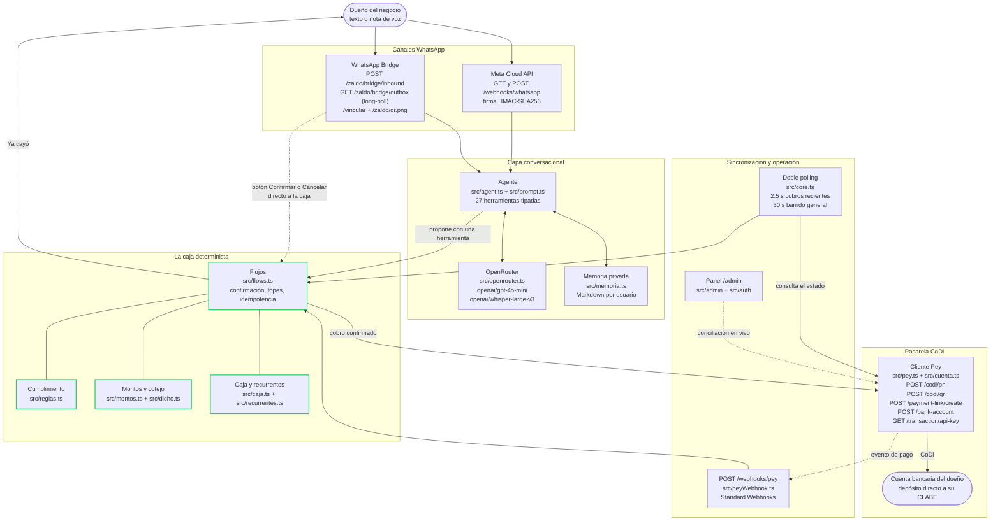

<div align="center">


# Zaldo

### Punto de venta y agente de cobros CoDi dentro de WhatsApp,<br>con depósito directo a tu CLABE.

Le escribes o le mandas una nota de voz. Zaldo arma el cobro, te pide confirmar,<br>
lo emite por CoDi y te avisa cuando el banco lo confirma. El dinero nunca pasa por Zaldo.

<br>


<br>

**[Probar el bot en WhatsApp](https://wa.me/525649774094?text=Hola%20Zaldo)** &nbsp;·&nbsp; **[Landing en vivo](https://zaldo.ih0st.app)** &nbsp;·&nbsp; [Arquitectura](#arquitectura) &nbsp;·&nbsp; [Seguridad](#seguridad) &nbsp;·&nbsp; [Quickstart](#quickstart)

</div>

<br>

## La tesis en 20 segundos

En México, la estética, la tiendita, el freelancer y la cuenta entre amigos ya viven en WhatsApp. El cobro no: ahí se sigue dictando una CLABE de 18 dígitos, persiguiendo capturas de transferencia o pagando la comisión de una terminal y de una app aparte.

CoDi ya resuelve la parte bancaria: cobro al instante, de banco a banco. Lo que faltaba era una forma de usarlo sin salir del chat. Zaldo es esa forma: un punto de venta completo que se opera hablando, y que deposita directo en la cuenta del dueño.

<table>
<tr>
<td width="33%" align="center"><br><sub><b>Negocios</b> · QR fijo en el mostrador</sub></td>
<td width="33%" align="center"><br><sub><b>Freelancers</b> · cobro al celular del cliente</sub></td>
<td width="33%" align="center"><br><sub><b>Entre personas</b> · la cuenta, sin dictar CLABE</sub></td>
</tr>
</table>

### El recorrido, en 4 pasos

| | Paso | Qué pasa de verdad |
|:-:|---|---|
| **1** | **Conecta tu CLABE una sola vez** | Zaldo manda un enlace HTTPS firmado y de un solo uso (`/cuenta?t=...`, vigente 30 minutos). La CLABE se captura en esa página y se entrega a Pey con `POST /bank-account`: no pasa por el chat y Zaldo no la guarda. |
| **2** | **Pide el cobro por texto o nota de voz** | *«Cóbrale $350 a Sofi»*, *«QR fijo para mostrador»*, *«Link con propina»*, *«2 gelish a Ana»*. |
| **3** | **Confirma en un toque** | Antes de emitir cualquier cobro llega una tarjeta con el desglose, a quién le llega y dos botones: Confirmar y Cancelar. |
| **4** | **«Ya cayó»** | El aviso sale en cuanto Pey confirma el pago, por webhook o por consulta directa a Pey, lo que ocurra primero. El dinero cae en la cuenta bancaria del dueño: Zaldo nunca concentra dinero de nadie. |

<br>

## Arquitectura

> **El modelo conversa; la caja decide.**

El LLM entiende lo que pide la persona y propone una acción llamando a una herramienta. Ahí termina su autoridad. Montos, reglas de cumplimiento, confirmación, topes e idempotencia viven en código determinista, que coteja cada dato contra lo que la persona escribió de verdad. Confirmar y Cancelar ni siquiera pasan por el modelo.



| Capa | Archivos | Responsabilidad |
|---|---|---|
| **Canales WhatsApp** | `src/whatsapp.ts`, `src/core.ts`, `src/botones.ts`, `src/estilo.ts` | Dos entradas equivalentes. **Meta Cloud API**: `GET /webhooks/whatsapp` (verificación) y `POST /webhooks/whatsapp` (firma `X-Hub-Signature-256`). **WhatsApp Bridge**: `POST /zaldo/bridge/inbound` recibe mensajes, botones y audios (transcritos con Whisper vía OpenRouter); `GET /zaldo/bridge/outbox` entrega avisos por long-poll; `/vincular` y `/zaldo/qr.png` enlazan el dispositivo. El proceso del puente corre en el servidor anfitrión; este repo implementa sus endpoints. |
| **Capa conversacional** | `src/agent.ts`, `src/openrouter.ts`, `src/prompt.ts`, `src/memoria.ts` | OpenRouter con `openai/gpt-4o-mini` para conversar y `openai/whisper-large-v3` para notas de voz. 27 herramientas tipadas con JSON Schema. Memoria privada por usuario en Markdown, en cuatro secciones: Negocio, Clientes, Costumbres y Pendientes. |
| **La caja determinista** | `src/flows.ts`, `src/reglas.ts`, `src/montos.ts`, `src/dicho.ts`, `src/caja.ts`, `src/recurrentes.ts` | Valida que cada monto salga de lo que la persona dijo, del catálogo o de un fiado apuntado. Aplica las barreras de cumplimiento. Exige confirmación con botones `c:<uuid>` / `x:<uuid>`. Controla topes y ejecuta la idempotencia de mensajes y eventos. |
| **Pasarela CoDi** | `src/pey.ts`, `src/peyWebhook.ts`, `src/cuenta.ts` | Cliente de la API de Pey: `POST /codi/pn`, `POST /codi/qr`, `POST /payment-link/create`, `POST /bank-account`, `GET /transaction/api-key`. Cada cobro viaja con `metadata.chargeId` para poder conciliarlo después. |
| **Sincronización y operación** | `src/core.ts`, `src/server.ts`, `src/admin/*`, `src/auth/*` | Webhook `POST /webhooks/pey` verificado con Standard Webhooks, más doble polling contra Pey, más el panel `/admin`. |

**Por qué dos relojes.** Un webhook puede no llegar; un pago no puede quedarse sin aviso. `src/core.ts` corre una vuelta rápida cada `2.5 s` que le pregunta a Pey por los cobros recién emitidos (en cada vuelta durante los primeros 3 minutos; una de cada cuatro vueltas hasta los 15 minutos) y un barrido general cada `30 s` que además vence cobros, dispara los recurrentes y revisa si Banxico ya activó las cuentas nuevas.

<details>
<summary><b>Las 27 herramientas del agente</b> (nombres reales de <code>src/agent.ts</code>)</summary>

<br>

| Dominio | Herramienta | Para qué |
|---|---|---|
| **Cobros y QR** | `prepare_charge` | Arma el cobro: ticket o monto, quién paga, método (`push`, `qr`, `link`), propina, QR fijo, monto abierto o recurrencia. |
| | `repeat_charge` | Repite un cobro anterior, a la misma persona o a otra, con otro monto o método. |
| | `ask_choice` | Hace una pregunta con dos o tres opciones tocables. |
| | `confirm_charge` | Confirma el cobro que está esperando. |
| | `cancel_charge` | Cancela el cobro que está esperando. |
| | `charge_status` | Consulta a Pey el estado de un cobro («¿ya pagó Ana?»). |
| | `close_fixed_qr` | Cierra el QR fijo del mostrador. |
| **Recurrentes** | `list_recurring` | Lista a quién, cuánto, cada cuándo y cuándo toca el siguiente. |
| | `update_recurring` | Cambia el monto o la frecuencia. |
| | `cancel_recurring` | Detiene el cobro recurrente de un cliente. |
| | `resume_recurring` | Retoma uno que quedó en pausa. |
| **Caja y corte** | `get_balance` | Corte de caja por periodo. |
| | `undo_last` | Borra el último apunte de la caja. |
| **Fiado y gastos** | `add_note` | Apunta sin mover dinero: `gasto`, `ingreso`, `deuda` (fiado) o `debo`. |
| | `settle_debt` | Registra el pago de un fiado o una deuda fuera de CoDi, completo o en parte. |
| **Catálogo y contactos** | `set_product` | Agrega un producto o servicio, o cambia su precio. Precio 0 lo quita. |
| | `list_products` | Muestra el catálogo con precios. |
| | `save_contact` | Guarda un cliente con su celular de 10 dígitos. |
| | `list_contacts` | Lista los clientes guardados. |
| **Cuenta CLABE y estado** | `connect_bank` | Manda el enlace firmado para registrar o cambiar la CLABE. |
| | `account_status` | A qué cuenta cae el dinero, si ya está activa en CoDi, modo de prueba y tope del día. |
| | `pey_payments` | Los últimos pagos como los registró Pey, con su comisión. |
| **Memoria, perfil y ayuda** | `remember` | Guarda una nota del negocio, sus clientes, costumbres o pendientes. |
| | `forget` | Olvida un dato, o todo. |
| | `set_profile` | Guarda el nombre y el celular de quien escribe. |
| | `set_business` | Guarda el nombre del negocio y la meta de venta diaria. |
| | `show_help` | Muestra todo lo que Zaldo sabe hacer, con ejemplos. |

</details>

<br>

## Capacidades del POS conversacional

| Capacidad | Cómo funciona | Detalle técnico |
|---|---|---|
| **CoDi Push** | Notificación de cobro directo a la app bancaria del cliente, con solo su celular de 10 dígitos. | `POST /codi/pn` · expira a los `360 s` |
| **CoDi QR dinámico** | Imagen QR lista para mostrar o reenviar, generada con `qrcode` a partir del `qrString` de Pey. | `POST /codi/qr` · expira en `1 h` |
| **QR fijo de mostrador** | No vence y recibe muchos pagos; cada uno cae como una venta aparte. También de monto abierto: quien paga escribe la cantidad. | `fixed: true` en `prepare_charge` → cobro `reusable`, sin vencimiento · `openAmount: true` |
| **Links de pago** | Liga de pago con CoDi o tarjeta y propina opcional. Requiere `PUBLIC_BASE_URL`. | `POST /payment-link/create` · `hasTip` · páginas `/pago/listo` y `/pago/volver` |
| **Catálogo, tickets y descuentos** | Productos y servicios con precio unitario; ticket de varios renglones con ajustes por descuento, propina o envío. Los totales salen del catálogo, no del modelo. | `ChargeItem` en `src/store.ts` |
| **Caja, corte y gastos** | Ventas CoDi y en efectivo, ticket promedio, lo más vendido, gastos, lo que queda y la meta del día. Hora de Ciudad de México (`UTC−6`). | `src/caja.ts` · periodos `hoy`, `ayer`, `semana`, `mes`, `mes_pasado` · 8 categorías de gasto: `insumos`, `renta`, `servicios`, `sueldos`, `transporte`, `publicidad`, `comida`, `otros` |
| **Fiados y deudas** | Lo que te deben (`deuda`) y lo que debes (`debo`), con abonos parciales. Si el cliente paga por CoDi, su fiado se abona solo. | `settleDebts` en `src/caja.ts` |
| **Cobros recurrentes** | Se confirma una vez; después Zaldo manda la notificación solo y avisa. A los `3` periodos seguidos sin pagar, se pausa. | `src/recurrentes.ts` · `semanal`, `quincenal`, `mensual` |

<br>

## Seguridad

Zaldo emite cobros que le llegan a una persona en la app de su banco. Eso obliga a proteger a los dos lados: al comercio que cobra y a quien paga. Estas garantías están en código, no en el prompt.

| Candado | Qué garantiza | Dónde vive |
|---|---|---|
| **Cero almacenamiento de CLABE** | El enlace `/cuenta?t=...` va firmado con HMAC-SHA256, es de un solo uso y caduca a los `30 min`. Admite máximo `8` intentos por enlace y `3` cuentas por persona. La CLABE se valida con su dígito verificador y se entrega a Pey por HTTPS; Zaldo conserva únicamente el `bankAccountId` y los últimos `4` dígitos. La CLABE completa no queda en el libro ni en los logs. | `src/cuenta.ts` |
| **Filtro duro de cumplimiento** | Un cobro no se emite si suplanta a una institución o empresa (SAT, Banxico, BBVA, Mercado Pago, Pey y más), si usa urgencia de phishing, si pide secretos (NIP, CVV, datos de tarjeta, contraseñas), si amenaza, o si es de un giro restringido: apuestas, préstamos con interés («gota a gota»), rifas, cripto, remesas, pirámides. | `src/reglas.ts` · `chargeViolation` |
| **Memoria sin secretos** | Lo que parezca un secreto, un número de tarjeta o una CLABE no se guarda en la memoria. Tampoco las órdenes disfrazadas de «recuerda que...». | `looksSensitive`, `looksLikeInstruction` |
| **Tope diario** | Tope de cobros confirmados por día. | `DAILY_CAP_MXN` (default `5000`) |
| **Anti cobro en masa** | Máximo `3` notificaciones CoDi sin pagar al mismo celular en `24 h`. | `src/agent.ts` |
| **Confirmación obligatoria** | Ningún cobro sale sin Confirmar. La tarjeta caduca a los `15 min`. | `src/flows.ts` |
| **Modo de prueba** | Tope por cobro mientras se usa la cuenta de pruebas de Pey. | `PEY_TEST_MAX_MXN` |
| **Idempotencia** | Cada mensaje y cada evento de Pey se reclama una sola vez: un reintento no duplica cobros ni avisos. | `store.claim` |
| **Lista blanca** | Opcional: solo los celulares listados pueden usar el bot. | `ALLOWED_PHONES` |
| **Webhooks firmados** | Meta: `X-Hub-Signature-256` con HMAC-SHA256 sobre el cuerpo crudo. Pey: verificación con `standardwebhooks`. Comparaciones en tiempo constante. | `src/whatsapp.ts`, `src/peyWebhook.ts` |
| **Panel `/admin`** | Contraseñas con `scrypt`. Sesión en cookie firmada, `HttpOnly`, `SameSite=Strict` y `Secure`. Token CSRF. Freno contra fuerza bruta por IP y por usuario. `Content-Security-Policy: default-src 'none'` y `X-Frame-Options: DENY`. Celulares enmascarados y rutas de usuario con identificador opaco derivado por HMAC. | `src/auth/*`, `src/admin/*` |

<br>

## Panel administrativo y conciliación en vivo

El panel solo lee. No crea cobros ni manda WhatsApp, así que entrar a `/admin` nunca mueve dinero. `src/auth/` es el login y no sabe nada de cobros; `src/admin/` es el panel.

| Ruta | Qué muestra |
|---|---|
| `/admin` | Resumen: cobrado hoy contra el tope diario, pendiente, pagado, conversión y serie diaria. |
| `/admin/cobros` | Todos los cobros, con filtros por estado, método, dueño y texto. |
| `/admin/cobros.csv` | La misma consulta en CSV, hasta `5,000` filas. |
| `/admin/usuarios` | Un renglón por celular que usa Zaldo. |
| `/admin/usuarios/<ref>` | Detalle de un usuario: cobros, contactos y apuntes. `<ref>` es opaco, no el celular. |
| `/admin/conciliacion` | Lo que Pey dice que cobró (`GET /transaction/api-key`) frente al libro de Zaldo. |
| `POST /admin/conciliacion/reparar` | Vuelve a preguntarle a Pey por una transacción y corrige el libro solo si Pey la confirma. Es el único `POST` del panel. |
| `/admin/ajustes` | La configuración en vigor, sin las llaves. |
| `/admin/metricas.json` | Las métricas del resumen en JSON. |

La conciliación cruza por `metadata.chargeId` y señala cuatro descuadres: pagado en Pey pero no en Zaldo, pagado en Zaldo pero no en Pey, monto distinto y dinero que entró sin cobro local.

**Apagado seguro.** Si falta `ADMIN_USERS` o `ADMIN_SESSION_SECRET` (mínimo 32 caracteres), el panel queda apagado, `/admin` responde `404` y el bot corre igual.

<br>

## Hot-publish sin redeploy

En producción Zaldo vive dentro de otro servidor, en [zaldo.ih0st.app](https://zaldo.ih0st.app). Ni el bot ni la landing necesitan un push o un deploy de ese servidor para actualizarse.

**`ZaldoCore`: el bot en un solo archivo**

`src/core.ts` expone una interfaz chica y estable (`handle`, `stop`, `api`, `build`). Todo lo que Zaldo contesta en producción sale de ahí.

```bash
npm run zaldo:publish     # corre los tests, empaqueta src/core.ts y cambia el bot en caliente
npm run zaldo:status      # qué versión corre (también se ve en /health)
npm run zaldo:rollback    # vuelve a la versión anterior
```

1. `scripts/publish-core.ts` corre la suite de pruebas. Si falla, no publica.
2. `scripts/bundle-core.ts` empaqueta con `esbuild` un único archivo sin dependencia de `node_modules` y calcula su sha256.
3. Lo sube a `https://zaldo.ih0st.app/zaldo/core` con el header `x-zaldo-sha256`, autenticado con `ZALDO_CORE_TOKEN`.
4. El servidor comprueba el hash, carga el paquete y lo cambia en caliente, sin reiniciar. El libro de cobros, el catálogo y el fiado siguen igual.

> `ZALDO_CORE_TOKEN` permite ejecutar código en el servidor. Trátalo como una contraseña: va en `.env`, nunca en git.

**`landing/`: el sitio estático**

```bash
npm run landing:publish   # sube la carpeta una vez
npm run landing:watch     # la vuelve a subir cada que guardas
```

`scripts/publish-landing.ts` sube `landing/` completo con `ZALDO_PUBLISH_TOKEN`. La landing incluye un demo interactivo en 3D (`landing/phone3d.js`) con Three.js servido localmente desde `landing/vendor/`, sin CDN.

<br>

## Quickstart

**Stack, sin relleno.** Servidor HTTP nativo `node:http` sobre Node `>= 20`, en ESM (`"type": "module"`). Tres dependencias de producción: `openai`, `qrcode` y `standardwebhooks`. En desarrollo: TypeScript `5.7`, `tsx` y `esbuild`.

```bash
npm install
cp .env.example .env              # llena las llaves; .env no se sube a git

npm run admin:hash -- tu-usuario  # opcional: genera ADMIN_USERS y ADMIN_SESSION_SECRET
npm run pey:test-account          # opcional: cuenta de pruebas de Pey (lee la nota de abajo)

npm run dev                       # tsx watch src/index.ts
npm test                          # las 15 suites
npm run typecheck                 # tsc --noEmit
```

WhatsApp y Pey tienen que poder llegar al servidor por HTTPS:

- `https://TU_URL/webhooks/whatsapp` — en Meta, el token de verificación es tu `WHATSAPP_VERIFY_TOKEN`.
- `https://TU_URL/webhooks/pey` — en el portal de Pey hay un webhook por API key; su secreto va en `PEY_WEBHOOK_SECRET`.

> **Cuenta de pruebas.** La API key necesita una cuenta CoDi activa. Mientras Banxico activa la tuya (hasta 5 días hábiles), `npm run pey:test-account` muestra qué haría, y con `-- --go` registra la CLABE de pruebas que documenta Pey. Lo que se pague a esa cuenta **no se devuelve ni llega a tu banco**: deja `PEY_TEST_MAX_MXN` en un monto mínimo.

> **Persistencia.** El libro vive en el archivo de `DATA_PATH`. En un PaaS, apúntalo a un volumen persistente: el disco de un contenedor se borra en cada redeploy.

<details>
<summary><b>Variables de entorno</b> (<code>.env.example</code>)</summary>

<br>

**Obligatorias**

| Variable | Para qué |
|---|---|
| `OPENROUTER_API_KEY` | Llave de OpenRouter. El modelo tiene que saber usar tools. |
| `PEY_API_KEY` | Llave de la API de Pey, con una cuenta CoDi ligada. |
| `PEY_WEBHOOK_SECRET` | Secreto del webhook de Pey (Standard Webhooks). |
| `WHATSAPP_ACCESS_TOKEN` | Token de WhatsApp Cloud API. |
| `WHATSAPP_PHONE_NUMBER_ID` | Id del número en Meta. |
| `WHATSAPP_APP_SECRET` | Secreto de la app: verifica `X-Hub-Signature-256`. |
| `WHATSAPP_VERIFY_TOKEN` | Lo inventas tú y lo pegas igual en Meta. También autentica al puente. |

**Operación y límites**

| Variable | Default | Para qué |
|---|---|---|
| `PORT` | `3000` | Puerto del servidor. |
| `OPENROUTER_MODEL` | `openai/gpt-4o-mini` | Modelo conversacional. |
| `OPENROUTER_TRANSCRIBE_MODEL` | `openai/whisper-large-v3` | Transcripción de notas de voz. |
| `PEY_API_BASE` | `https://api.pey.mx` | Base de la API de Pey. |
| `PEY_BANK_ACCOUNT_ID` | vacío | Cuenta que recibe los cobros, si no es la ligada a la llave. |
| `PEY_TEST_MAX_MXN` | vacío | Tope por cobro en modo de prueba. Vacío lo apaga. |
| `ALLOWED_PHONES` | vacío | Celulares permitidos, separados por coma. Vacío acepta a quien escriba. |
| `DAILY_CAP_MXN` | `5000` | Tope de cobros confirmados por día, en pesos. |
| `PUBLIC_BASE_URL` | vacío | URL pública `https://`. Hace falta para el link de pago. |
| `DATA_PATH` | `./data/zaldo.json` | Dónde vive el libro. |

**Panel admin**

| Variable | Default | Para qué |
|---|---|---|
| `ADMIN_USERS` | vacío | `usuario:hash` generado con `npm run admin:hash`. Varios, separados por comas. |
| `ADMIN_SESSION_SECRET` | vacío | Al menos 32 caracteres. |
| `ADMIN_SESSION_HOURS` | `8` | Duración de la sesión. |
| `ADMIN_MAX_ATTEMPTS` | `5` | Intentos fallidos antes del bloqueo. |
| `ADMIN_LOCKOUT_MINUTES` | `15` | Duración del bloqueo. |
| `ADMIN_COOKIE_SECURE` | `true` | Pon `false` solo para probar en `http://localhost`. |
| `ADMIN_TRUST_PROXY` | `false` | `true` detrás de un proxy, para contar la IP real del visitante. |

**Publicación en caliente**

| Variable | Default | Para qué |
|---|---|---|
| `ZALDO_PUBLISH_TOKEN` | vacío | Autoriza `landing:publish` y `landing:watch`. |
| `ZALDO_PUBLISH_URL` | `https://zaldo.ih0st.app/zaldo/site` | Destino de la landing. |
| `ZALDO_CORE_TOKEN` | vacío | Autoriza `zaldo:publish`. 32 caracteres o más. |
| `ZALDO_CORE_URL` | `https://zaldo.ih0st.app/zaldo/core` | Destino del bot. |

</details>

<details>
<summary><b>Scripts, mapa del repo y pruebas</b></summary>

<br>

**Los 11 scripts de `package.json`**

| Script | Qué hace |
|---|---|
| `npm run dev` | `tsx watch src/index.ts` |
| `npm start` | `tsx src/index.ts` |
| `npm test` | Corre las 15 suites con `tsx --test` |
| `npm run typecheck` | `tsc --noEmit` |
| `npm run admin:hash` | Genera el hash `scrypt` de un admin y un secreto de sesión |
| `npm run pey:test-account` | Registra o revisa la cuenta de pruebas de Pey |
| `npm run zaldo:publish` | Prueba, empaqueta y publica el bot en caliente |
| `npm run zaldo:status` | Dice qué versión corre en producción |
| `npm run zaldo:rollback` | Vuelve a la versión anterior |
| `npm run landing:publish` | Sube `landing/` una vez |
| `npm run landing:watch` | Sube `landing/` cada que guardas |

**Mapa del repo**

```text
Zaldo/
├── src/
│   ├── index.ts          arranque local: config, store, servidor y relojes
│   ├── server.ts         servidor node:http: webhooks, landing y /admin
│   ├── core.ts           ZaldoCore: el bot que se publica en caliente
│   ├── agent.ts          el agente y sus 27 herramientas
│   ├── openrouter.ts     chat y transcripción vía OpenRouter
│   ├── prompt.ts         instrucciones del modelo
│   ├── memoria.ts        memoria por usuario en Markdown
│   ├── flows.ts          confirmación, emisión, avisos, conciliación y recurrentes
│   ├── reglas.ts         lo que no se cobra ni se guarda
│   ├── montos.ts         lectura y verificación de montos
│   ├── dicho.ts          cotejo contra lo que la persona escribió
│   ├── caja.ts           periodos, gastos, fiado y corte
│   ├── recurrentes.ts    cobros recurrentes sobre el libro
│   ├── pey.ts            cliente de la API de Pey
│   ├── peyWebhook.ts     verificación Standard Webhooks
│   ├── cuenta.ts         página /cuenta: registro de CLABE
│   ├── whatsapp.ts       WhatsApp Cloud API y firma de Meta
│   ├── botones.ts        formatos de botones por el puente
│   ├── estilo.ts         formato de WhatsApp para cada mensaje
│   ├── store.ts          el libro: cobros, perfiles, notas, recurrentes
│   ├── fileStore.ts      persistencia en archivo
│   ├── landing.ts        sirve landing/ como estático
│   ├── config.ts  envFile.ts  inbound.ts  money.ts  phone.ts
│   ├── admin/            panel: data, layout, reconcile, routes, views
│   └── auth/             login: config, password, session, throttle, service, routes
├── scripts/              bundle-core, publish-core, publish-landing, hash-password, pey-test-account
├── landing/              sitio estático, demo 3D, assets/ y vendor/ (Three.js)
└── test/                 15 suites
```

**Las 15 suites de prueba** (`test/<nombre>.test.ts`)

`zaldo` · `admin` · `landing` · `caja` · `versatil` · `cuenta` · `montos` · `reglas` · `dicho` · `puente` · `flujos` · `candados` · `botones` · `memoria` · `estilo`

</details>

<br>

---

<div align="center">

Hecho por el equipo de **Zaldo** para **Hackatón México 2026**.

[Repositorio](https://github.com/LuisandovalU/Zaldo) &nbsp;·&nbsp; [Chat demo en WhatsApp](https://wa.me/525649774094?text=Hola%20Zaldo) &nbsp;·&nbsp; [zaldo.ih0st.app](https://zaldo.ih0st.app)

</div>
